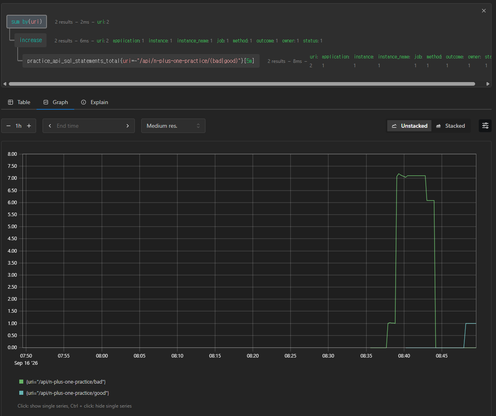

# Spring Boot JPA N+1 Observability Practice

This repository is a hands-on Spring Boot experiment that proves one backend lesson:

```text
An API response can look correct in Postman,
but the database can still be doing too much hidden work.
```

## Main Result

Postman was used to call two endpoints:

```text
GET /api/n-plus-one-practice/bad
GET /api/n-plus-one-practice/good
```

Both endpoints return a normal-looking API response.

But Prometheus shows a different internal cost:



```text
/bad
-> one HTTP request
-> ChatLog list query
-> LAZY User access during DTO conversion
-> repeated User SELECT queries
-> N+1 detected

/good
-> one HTTP request
-> fetch join loads ChatLog and User together
-> repeated User SELECT queries reduced
-> hidden SQL cost improved
```

## What I Actually Tested

The experiment created sample data:

```text
5 PracticeUser rows
5 PracticeChatLog rows
Each ChatLog has @ManyToOne(fetch = LAZY) PracticeUser
```

Then `/bad` used the normal lazy-loading path:

```text
practiceChatLogRepository.findAll()
-> DTO conversion calls chatLog.getUser().getName()
-> Hibernate loads each user one by one
```

Expected SQL pattern:

```sql
select ... from practice_chat_log ...
select ... from practice_user where id=?
select ... from practice_user where id=?
select ... from practice_user where id=?
...
```

Then `/good` used fetch join:

```text
practiceChatLogRepository.findAllWithUser()
-> join fetch loads ChatLog and User together
-> DTO conversion does not trigger repeated user SELECT queries
```

Expected SQL pattern:

```sql
select ...
from practice_chat_log ...
join practice_user ...
```

## Prometheus Query

```promql
sum by(uri) (
  increase(practice_api_sql_statements_total{uri=~"/api/n-plus-one-practice/(bad|good)"}[5m])
)
```

## Why This Matters

Postman proves the API works.

Prometheus proves whether the API is internally expensive.

```text
API success is not enough.
Backend observability must expose hidden internal cost.
```

## Practice Flow

```text
1. Create sample data with Postman
2. Call /bad
3. Check Hibernate SQL logs
4. Check Prometheus SQL statement metric
5. Call /good
6. Compare SQL statement count
```

## APIs

```http
POST /api/n-plus-one-practice/sample-data
GET  /api/n-plus-one-practice/bad
GET  /api/n-plus-one-practice/good
```

## Run

```powershell
.\gradlew.bat bootRun
```

Health check:

```http
GET http://localhost:8080/actuator/health
```

Prometheus endpoint:

```http
GET http://localhost:8080/actuator/prometheus
```

## Portfolio Summary

```text
This project demonstrates JPA N+1 detection with real request testing.
Postman shows the response.
Hibernate SQL logs reveal repeated queries.
Prometheus turns the hidden SQL cost into visible metrics.
Fetch join reduces that cost, and the improvement is measurable.
```
